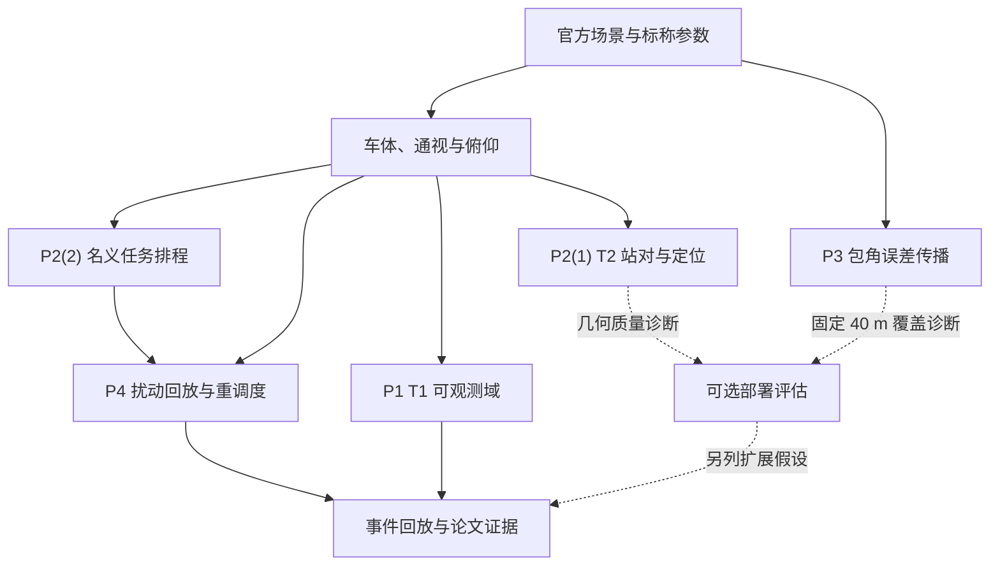

# B 题统一框架与依赖

官方硬依赖只有一条直接的跨问题方案依赖：P4 以 P2(2) 的名义排程为起点。P1 的可观测谓词可复用到所有目标，但 P1 的最佳站点和 T1 可行域坐标只属于 T1。P2(1) 的精度诊断和 P3 的误差分析可以扩展为治理信息。官方 PDF p.3 明定除 P3 指定误差情景外计算采用标称参数。

## 数据接口

| 模块 | 输入 | 输出及主键 | 验收 |
|---|---|---|---|
| 参数层 | 官方 PDF pp.1–5 | `data/B题题面参数.csv`，`group,entity,parameter` | 键唯一，角度单位明确，P4 冲突两份原值分别留档 |
| 观测几何 | 场界、建筑、相机高、目标、车体半径 | `target_id,station_id`，xy、可行三标志、相机方位和俯仰、约束余量 | LOS 接触失败，车体与俯仰等号按题设，角度包绕固定 |
| 路线 | 起终点、车体约束、版本 | `route_id`、路点、每段长、总长、速度、误差/保守标签 | 轨迹端点对齐，整段安全，可选短路证书 |
| P2(1) | T2 各站的可达路线与成对方位 | 车辆站对、基线 m、交会角 °、行车 s、精度 m、指标定义 | 独立确认量纲和选站证书；到达时限仅属这一问 |
| P2(2) | 多目标可行站、路线、正东初态、阶段耗时 | `policy,vehicle,alert,visit`、站点、轨迹、depart/arrival/ready/start/end/reset | 同一告警两车同步；资源串行；导出每车完成时间用于时间线 |
| P3 | 里程 m、固定 40 m、噪声模型 | 覆盖率、阈值、$a,b$ 参数边界、分量贡献和误差说明 | 概率曲线/区间/阈值标口径，噪声不与 P2(1) 的 1° 重复叠加 |
| P4 | 冻结名义计划哈希、事件、断联口径、存续车辆状态 | `case,policy`、$(k,N,η,t_{last})$、已执行/取消/未执行、车辆事件序列 | 同一 case 两策略初态一致；已开测锁定；失败车与断联分支明确 |
| 展示 | 只读版本固定的数据、路径和逐事件时刻 | 论文 PDF/PNG、可选交互回放 | 帧位置、图标和分数均可回指结果行；三维视图只显示标称事实 |

## 指标边界

| 用途 | 应用指标 | 可选诊断 |
|---|---|---|
| P1 | $Q$ 及其站点、水平距、俯仰 | 面积估计、裕度、准备时间仅作平局或解释 |
| P2(1) | 明示定义的水平定位精度 | 条件数、椭圆、分位误差或失效率需相应定义 |
| P2(2) | 最晚观测开始 | 总里程、时间分解、等待、复用次数、交会角 |
| P3 | 5° 内覆盖率与 95% 门槛 | 分量贡献、数值收敛和安全余量 |
| P4 | 先完成率，再最晚开测；未全完成取 60 s | 首个改派时刻和故障后的恢复延迟只在明确起止事件时报告 |

静态站位输出给排程的是可行域与可选诊断。动态重调度继承的是车辆实时 xy、当前阶段、已执行历史、待办和最早再可用时刻。P3 的累计里程可从轨迹记录读取，直接应用覆盖结果的前提是同一观测距离场景。实时变化的视距需要队员另行定义并验证扩展。压线站点可做离线敏感性剖面，保留官方标称结果作为主结果。跨学科论证应跟随这几条接口，避免把所有量加权成单一评分。

**现状。** 现存 CSV/JSON 与源码已经实现公共几何、P2(2)→P4、独立的 P3 验证三条链。P2(1) 的精度既没有成为名义调度的正式目标，也没有覆盖 P4 的概率可靠性。计划哈希及派生结果作为定稿治理项，见 [验收报告](VERIFY_REPORT.md)。

